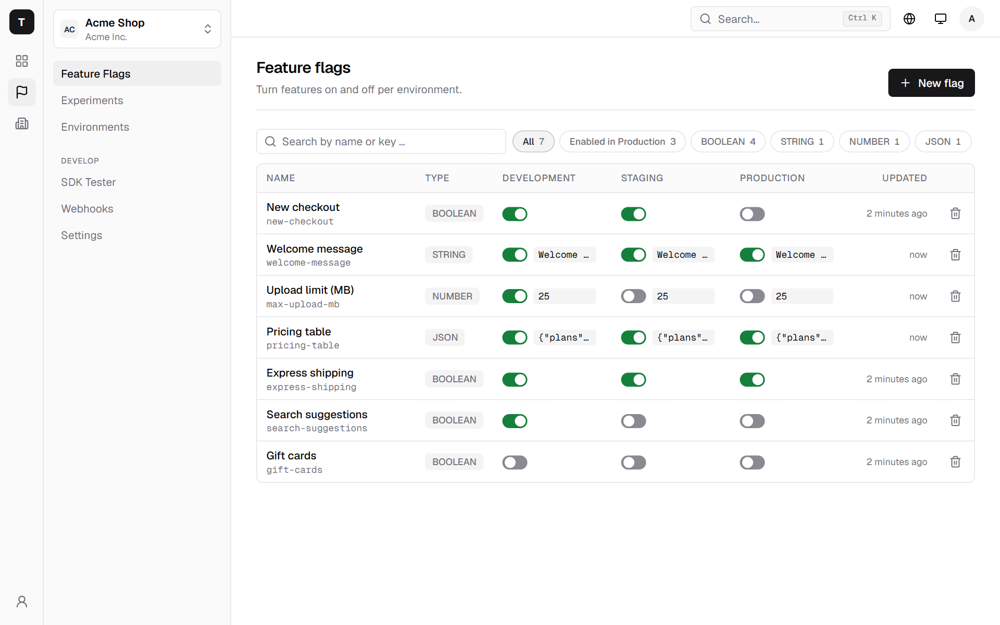
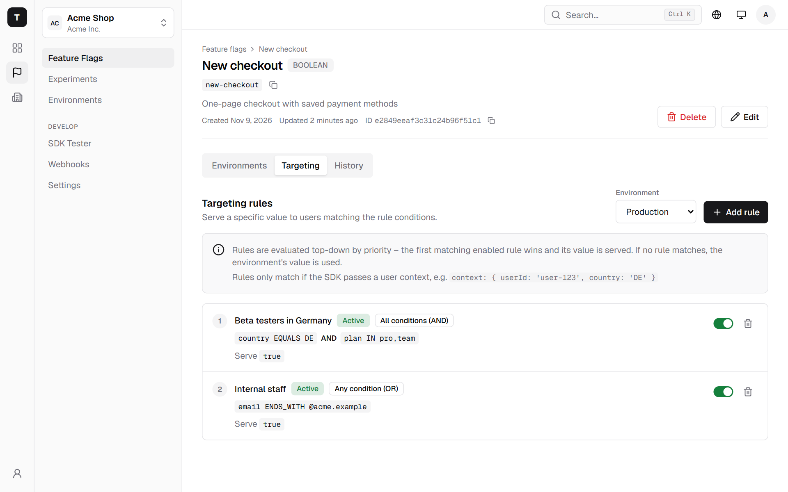
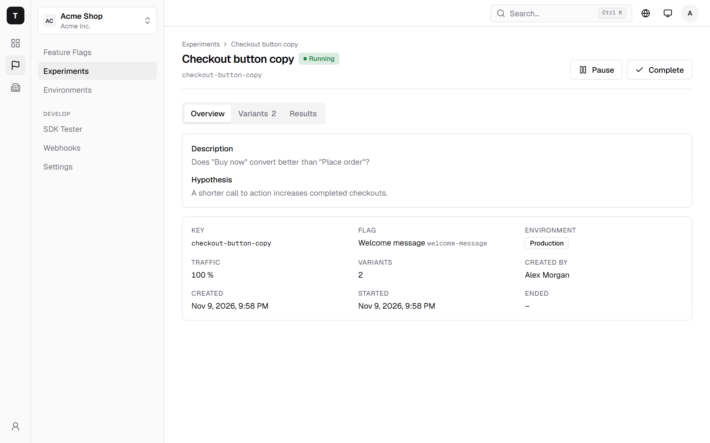
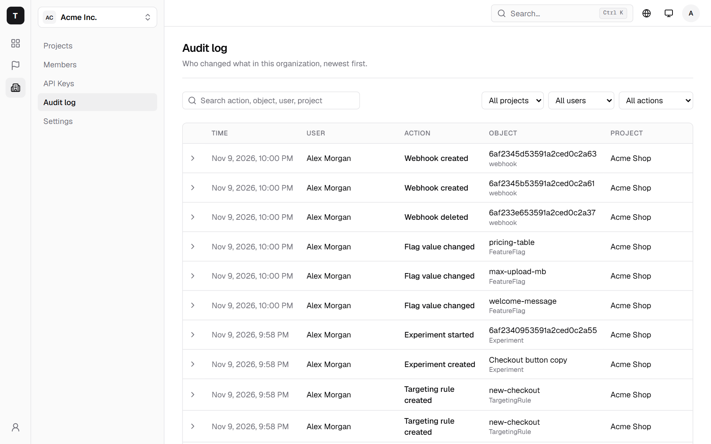
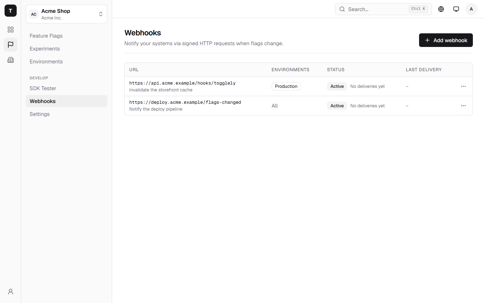

# 🚩 Togglely - Feature Toggle Management Platform

<picture>
  <source media="(prefers-color-scheme: dark)" srcset="docs/images/flags-dark.png">
  
</picture>

A complete, self-hosted Feature Toggle Management Platform. Manage feature flags, organizations, projects, and environments with a modern web interface and a powerful API.

🌐 **Website**: [togglely.de](https://togglely.de/)  
📖 **Documentation**: [togglely.de/docs](https://togglely.de/docs)  
💻 **GitHub**: [github.com/nuvooo/togglely](https://github.com/nuvooo/togglely)

## ✨ Features

- 🔐 **User Authentication & Authorization**
  - JWT-based authentication
  - Role-based access control (Owner, Admin, Member, Viewer)
  - Organization-based multi-tenant architecture

- 🏢 **Organizations & Projects**
  - Multiple organizations per user
  - Projects within organizations
  - Team management with invitations

- 🌍 **Environments**
  - Development, Staging, Production
  - Independent flag states per environment

- 🚦 **Feature Toggles**
  - Multiple types: Boolean, String, Number, JSON
  - Targeting rules with conditions
  - Real-time updates

- 📊 **Audit Logs**
  - Traceability of all changes
  - Filtering by user, project, entity

- 🔑 **API Keys**
  - Server, Client, and SDK Keys
  - MCP Keys for AI agents (project-scoped, hashed, shown once)
  - Expiration dates and revocation

- 🤖 **AI Agents (MCP)**
  - Built-in MCP server at `/api/mcp` for Claude Code and other MCP clients
  - Create, update, toggle and clean up flags right from your editor
  - Toggling only in environments you allow per key, enforced server-side
  - Every change is audit-logged "via MCP key"

- 🚀 **SDKs for Various Languages**
  - Official JavaScript/TypeScript SDK
  - Easy integration into applications

## 📸 Screenshots

<table>
  <tr>
    <td width="50%">
      <picture>
        <source media="(prefers-color-scheme: dark)" srcset="docs/images/targeting-dark.png">
        
      </picture>
      <p align="center"><b>Targeting rules</b></p>
    </td>
    <td width="50%">
      <picture>
        <source media="(prefers-color-scheme: dark)" srcset="docs/images/experiment-dark.png">
        
      </picture>
      <p align="center"><b>Experiments</b></p>
    </td>
  </tr>
  <tr>
    <td width="50%">
      <picture>
        <source media="(prefers-color-scheme: dark)" srcset="docs/images/audit-log-dark.png">
        
      </picture>
      <p align="center"><b>Audit log</b></p>
    </td>
    <td width="50%">
      <picture>
        <source media="(prefers-color-scheme: dark)" srcset="docs/images/webhooks-dark.png">
        
      </picture>
      <p align="center"><b>Webhooks</b></p>
    </td>
  </tr>
</table>

## 🚀 Quick Start

### Prerequisites

- Docker 20.10+
- Docker Compose 2.0+

### Installation

1. **Clone the repository**

```bash
git clone https://github.com/nuvooo/togglely.git
cd togglely
```

2. **Create a `.env` with a JWT secret** (required, min. 32 chars)

```bash
echo "JWT_SECRET=$(openssl rand -hex 32)" > .env
```

3. **Start Docker Containers**

```bash
docker compose up -d --build
```

4. **Access the application**

- Frontend: http://localhost:3000
- Backend API: http://localhost:4000
- API Health: http://localhost:4000/health

On first start the app opens a setup page where you create the first account and organization.

## 📁 Project Structure

```
togglely/
├── backend/           # Node.js/Express Backend API
│   ├── src/
│   │   ├── controllers/   # API Controllers
│   │   ├── middleware/    # Express Middleware
│   │   ├── routes/        # API Routes
│   │   ├── services/      # Business Logic
│   │   └── utils/         # Utilities
│   └── prisma/            # Database Schema
├── frontend/          # React/TypeScript Frontend
│   └── src/
│       ├── components/    # React Components
│       ├── pages/         # Page Components
│       └── store/         # Zustand Stores
├── sdk/               # Official SDKs
│   └── javascript/    # JS/TS SDK
└── docker-compose.yml # Docker Compose Configuration
```

## 🔧 Development

### Backend

```bash
cd backend
npm install
npm run dev
```

Environment variables:
- `DATABASE_URL` - MongoDB connection URL
- `REDIS_URL` - Redis connection URL
- `JWT_SECRET` - Secret key for JWT
- `PORT` - API port (default: 4000)

### Frontend

```bash
cd frontend
npm install
npm run dev
```

### Database Migrations

```bash
cd backend
npx prisma migrate dev
npx prisma db seed
```

## 🤖 AI Agents (MCP)

Togglely ships an [MCP](https://modelcontextprotocol.io) server, so an AI agent such as Claude Code can create a flag while you plan a feature, toggle it while developing and remove it once the feature is rolled out — without leaving the editor.

### Connect Claude Code

1. In the dashboard go to **Organization → API Keys → Create** and choose **MCP (AI agent)**.
2. Pick the project and the environments the agent may toggle (e.g. only `development`). Without a selection the key can read, create and delete flags, but not toggle them.
3. Copy the command shown once after creation and run it:

```bash
claude mcp add --transport http togglely https://<your-togglely-host>/api/mcp \
  --header "Authorization: Bearer tkm_..."
```

### Tools

| Tool | What it does |
|------|--------------|
| `get_project` | Project, environments (incl. whether the key may toggle them), brands |
| `list_flags` / `get_flag` | Flags with their state per environment and brand override |
| `create_flag` | New flag (Boolean, String, Number, JSON) — starts off in every environment |
| `update_flag` | Change name or description |
| `set_flag_state` | Turn on/off or set the value — only in environments allowed for the key |
| `delete_flag` | Two steps (dry run, then `confirm`) — only if the flag has the same state everywhere and no targeting rules or running experiments |

### Security model

- One MCP key = one project. Keys are stored hashed (`tkm_` prefix) and shown only once.
- Any member can create their own MCP key; the key acts with the creator's current role.
- The environment lock and the delete rule are enforced by the server, not by the agent's prompt.
- Rate limits: 120 requests/min per key, 600 requests/min per IP. SDK endpoints reject MCP keys.

Details: [Connecting AI agents (MCP)](docs/API.md#ki-agenten-anbinden-mcp).

## 📡 API Endpoints

### Authentication

| Method | Endpoint | Description |
|--------|----------|-------------|
| POST | `/api/auth/register` | Register user |
| POST | `/api/auth/login` | Login |
| GET | `/api/auth/me` | Current user |

### Organizations

| Method | Endpoint | Description |
|--------|----------|-------------|
| GET | `/api/organizations` | List organizations |
| POST | `/api/organizations` | Create organization |
| GET | `/api/organizations/:id` | Organization details |
| GET | `/api/organizations/:id/members` | List members |

### Projects

| Method | Endpoint | Description |
|--------|----------|-------------|
| GET | `/api/projects/organization/:orgId` | List projects |
| POST | `/api/projects/organization/:orgId` | Create project |
| GET | `/api/projects/:id` | Project details |

### Feature Toggles

| Method | Endpoint | Description |
|--------|----------|-------------|
| GET | `/api/feature-flags/project/:projectId` | List flags |
| POST | `/api/feature-flags/project/:projectId` | Create flag |
| POST | `/api/feature-flags/:id/toggle` | Toggle flag |
| PATCH | `/api/feature-flags/:id/value` | Change value |

### SDK Endpoints (for client applications)

| Method | Endpoint | Description |
|--------|----------|-------------|
| GET | `/sdk/toggles/:environmentKey` | All toggles |
| GET | `/sdk/toggles/:environmentKey/:toggleKey` | Single toggle |
| POST | `/sdk/evaluate/:environmentKey/:toggleKey` | Evaluate with context |

## 💻 SDK Integration

### JavaScript/TypeScript

```bash
npm install @togglely/sdk
```

```typescript
import { TogglelyClient } from '@togglely/sdk';

const client = new TogglelyClient({
  apiKey: 'your-api-key',
  environment: 'production',
  baseUrl: 'https://your-togglely-instance.com'
});

// Check boolean toggle
const isEnabled = await client.isEnabled('new-feature');
if (isEnabled) {
  // Show new functionality
}

// Get string value
const message = await client.getString('welcome-message', 'Welcome!');

// Get number value
const limit = await client.getNumber('max-items', 10);

// Get JSON configuration
const config = await client.getJSON('app-config', {});

// With context (for targeting)
client.setContext({
  userId: '123',
  email: 'user@example.com',
  country: 'DE'
});
const isEnabledForUser = await client.isEnabled('beta-feature');
```

## 🏗️ Architecture

### Multi-Tenant Architecture

Togglely uses an organization-based multi-tenant architecture:

```
Users
  └── Organizations (Owner, Admin, Member, Viewer)
        └── Projects
              └── Environments (Dev, Staging, Prod)
                    └── Feature Toggles
                          └── Targeting Rules
```

### Database Schema

- **MongoDB**: Document-based database for all data
- **Redis**: Caching for SDK requests (30s TTL)

### Security

- Passwords hashed with bcrypt
- JWT for session management
- API Keys for SDK access
- Hashed, project-scoped MCP keys for AI agents with a server-side environment lock
- Role-based access control

## 📝 Environment Variables

| Variable | Description | Default |
|----------|-------------|---------|
| `DATABASE_URL` | MongoDB URL | - |
| `REDIS_URL` | Redis URL | - |
| `JWT_SECRET` | JWT Secret | - |
| `PORT` | API Port | 4000 |
| `NODE_ENV` | Environment | development |

## 🧪 Testing

```bash
# Backend Tests
cd backend
npm test

# Frontend Tests
cd frontend
npm test
```

## 📦 Deployment

### Docker Production

```bash
# Build
docker-compose -f docker-compose.yml build

# Start
docker-compose -f docker-compose.yml up -d
```

### Manual Deployment

1. Install MongoDB and Redis
2. Install Node.js 22+
3. Build and start backend
4. Build and serve frontend

### Password Reset Without Email

Without SMTP, users cannot receive reset mails. Two alternatives:

- **Organization owners** can create a one-time reset link for a member
  (`POST /api/organizations/:id/members/:userId/password-reset-link`).
  This only works if the owner owns *every* organization the user belongs to
  and the user is not an owner of any organization (owners may still reset
  their own account); otherwise the server administrator has to do it.
- **Server administrators** can create a reset link on the server:

```bash
docker exec -it togglely-backend node dist/cli reset-password 'user@example.com'
# without Docker: cd backend && npm run cli -- reset-password 'user@example.com'
```

Always wrap the email in single quotes: valid addresses may contain shell
metacharacters such as `$`, `` ` ``, `|` or `&`. A `'` inside the address is
written as `'\''`, e.g. `'o'\''brien@example.com'`.

The link is printed to the terminal, is valid for 1 hour and replaces any
previously issued reset link. No mail is sent. The command boots the backend's
application context: it needs the same environment (database, secrets) as the
server and runs the startup migrations before creating the link. The audit log
records it as `user.password_reset_link_created_by_operator` (actor: server
operator).

## 🤝 Contributing

Contributions are welcome! Please follow these steps:

1. Create a fork
2. Feature Branch: `git checkout -b feature/AmazingFeature`
3. Commit changes: `git commit -m 'Add some AmazingFeature'`
4. Push branch: `git push origin feature/AmazingFeature`
5. Create a Pull Request

## 📄 License

MIT License - see [LICENSE](LICENSE) for details.

## 🙏 Credits

- Built with React, Node.js, MongoDB, Redis
- Icons by Heroicons
